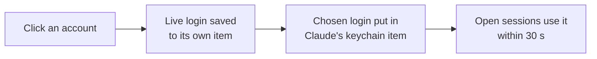

<p align="center">
  
</p>

<h1 align="center">Claude Switchboard</h1>

<p align="center">
  Switch Claude Code accounts from the macOS menu bar.<br>
  Every open session follows within seconds. Nothing restarts.
</p>

<p align="center">
  <a href="https://github.com/DanielT777/claude-switchboard/actions/workflows/test.yml"></a>
  <a href="https://github.com/DanielT777/claude-switchboard/releases/latest"></a>
  
  
  <a href="LICENSE"></a>
</p>

## Why

You have two Claude subscriptions, say work and personal, and one runs out mid-afternoon. Switching normally means logging out, logging in, and restarting every terminal where Claude was running.

Switchboard puts both accounts in the menu bar. One click, and every Claude Code session already open (any terminal, any number) carries on under the other account, in the same conversation, without restarting.

## How it works

Claude Code keeps its login in one macOS keychain item and rereads it on every request, with a cache of up to 30 seconds. Switchboard keeps each of your accounts in its own keychain item and, on a click, swaps the one Claude reads.



- **Only the Claude login moves.** MCP server logins stored in the same keychain item stay where they are.
- **No login is ever dropped.** The outgoing login is saved with any token Claude refreshed while it was live.
- **Adding an account never disturbs open sessions.** The official `claude auth login` runs in a throwaway folder; the new login goes straight to its own item.
- **A `/login` typed in a terminal is picked up** as an account on the next menu refresh.

A request already in flight finishes on the previous account. The menu bar shows a spinning icon for the 30 seconds it can take every session to follow.

## Features

- **Usage at a glance.** Session and weekly quotas in the menu bar, read from Claude's own status line. Per-model weeks and usage credits come from the reply Claude caches after `/usage`, with their age shown. No scraping, no polling, no extra prompts.
- **Instant menu.** It reads a few small files: no process scan, no `claude auth status`.
- **Your terminal, unchanged.** Keep typing `claude`, anywhere. Existing status lines keep working.
- **Signed auto-updates.** New versions arrive from GitHub releases and install only if signed by the maintainer's ed25519 key.
- **Speaks your language.** English or French, following your macOS language.

## Install

Requires macOS, [Claude Code](https://code.claude.com) and Node.js 22+. [SwiftBar](https://swiftbar.app) and Node are installed through Homebrew if missing.

```sh
git clone https://github.com/DanielT777/claude-switchboard.git
cd claude-switchboard && ./Install.command
```

Add your second account from the menu with **Add Account…**, which runs Claude's official login in a terminal. Then click it to switch.

> [!TIP]
> The menu follows your macOS language. To force one, set `"language": "en"` or `"fr"` in `~/.config/claude-switchboard/config.json`.

### Upgrading from 0.3

Version 0.3 ran each account in its own Claude folder and restarted sessions to switch. The installer removes its `claude` shell function and session hooks. Sessions started before the upgrade keep the account they started with until you restart them once; the menu counts them. Accounts other than your main one need **Connect** once, since their logins now live in Switchboard's keychain items.

## Update and uninstall

The menu shows **Update to vX.Y.Z…** when a new release is out; one click downloads it, verifies its ed25519 signature and SHA-256, and reinstalls in place. By hand: `claude-switchboard update`.

```sh
npm run uninstall:local
```

Uninstall removes the menu and the status line hook. Saved logins stay in the keychain (items named **Claude Switchboard**) and state stays in `~/.config/claude-switchboard`, so a reinstall finds them.

## Privacy

Everything stays on your Mac. Logins stay in the macOS keychain; Switchboard reads and writes them with Apple's `security` tool, as Claude Code itself does. State lives in `~/.config/claude-switchboard` with `0700`/`0600` permissions; conversations stay in `~/.claude/projects`. The only network request Switchboard makes on its own is the GitHub release check, at most every six hours.

Each account remains subject to [Anthropic's terms](https://www.anthropic.com/legal/consumer-terms). Switchboard switches between subscriptions you own; it does not pool or bypass usage limits.

## Contributing

Zero dependencies, `npm test` runs in under a second. See [CONTRIBUTING.md](CONTRIBUTING.md).

## License

MIT. Independent project, not affiliated with Anthropic or SwiftBar.
