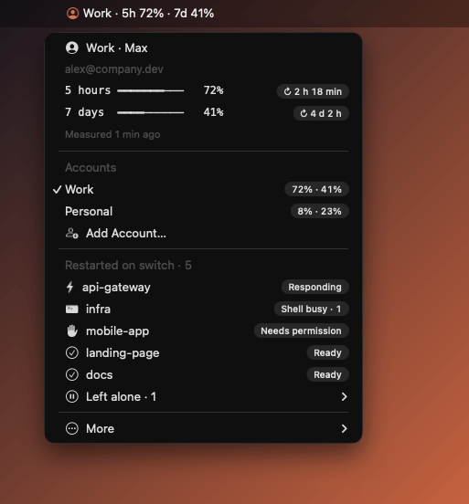
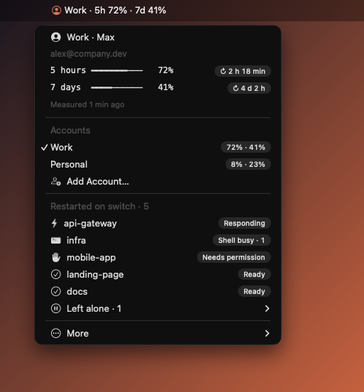
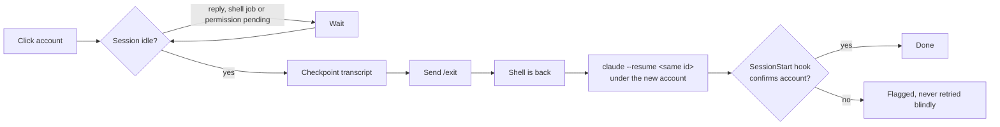

<p align="center">
  
</p>

<h1 align="center">Claude Switchboard</h1>

<p align="center">
  Switch Claude Code accounts from the macOS menu bar.<br>
  Your open sessions follow: same terminal, same conversation, new account.
</p>

<p align="center">
  <a href="https://github.com/DanielT777/claude-switchboard/actions/workflows/test.yml"></a>
  <a href="https://github.com/DanielT777/claude-switchboard/releases/latest"></a>
  
  
  <a href="LICENSE"></a>
</p>

<p align="center">
  
</p>

## Why

You have two Claude subscriptions, say work and personal. Switching means logging out, logging in, and restarting every terminal where Claude was running, losing your place in each conversation.

Switchboard puts both accounts in the menu bar. One click, and every open Claude Code session finishes its current reply, exits cleanly and resumes the same conversation under the other account, in the same pane.

## Features

- **Usage at a glance.** 5-hour and 7-day quotas in the menu bar, read from Claude's own status line. No scraping, no polling, no extra prompts.
- **One-click switch.** Sessions migrate in parallel, each one only once it is idle.
- **No surprises.** The menu lists exactly which sessions a switch will restart, and which it leaves alone and why.
- **Never destructive.** Switchboard never kills a process, never types over a draft, and saves a private transcript checkpoint before every exit.
- **Your terminal, unchanged.** Keep typing `claude`. Existing hooks and status lines keep working.
- **Signed auto-updates.** New versions arrive from GitHub releases and install only if signed by the maintainer's ed25519 key.
- **Speaks your language.** English or French, following your macOS language.

<p align="center">
  
</p>

## Works with

<p>
  
  
  
  
  
  
  
  
  
  
</p>

| Level | Meaning |
|---|---|
| **full** | Sessions already running before install are adopted and switched in place. |
| **new sessions** | Sessions started with `claude` after install are switched in place. Older ones work through tmux or Herdr. |
| **experimental** | Adapter written against the official scripting API, not yet tested end to end. |

Details and evidence per host: [compatibility matrix](docs/compatibility.md).

## Install

Requires macOS, [Claude Code](https://code.claude.com), Node.js 22+ and Python 3. [SwiftBar](https://swiftbar.app) and Node are installed through Homebrew if missing.

```sh
git clone https://github.com/DanielT777/claude-switchboard.git
cd claude-switchboard && ./Install.command
```

Open a new terminal and type `claude` as usual. Add your second account from the menu with **Add Account…**, which runs Claude's official login.

> [!TIP]
> The menu follows your macOS language. To force one, set `"language": "en"` or `"fr"` in `~/.config/claude-switchboard/config.json`.

## How a switch works



Each account is a separate Claude config directory created by the official `claude auth login`. Conversations, settings, commands and skills are shared through symlinks, so every account sees the same history. Credentials never leave Claude's own storage.

A session is left alone, and shown under **Left alone**, when its host cannot be controlled safely, when it is offline, or when its conversation file cannot be confirmed. Avoid typing in a session while it shows **Closing** or **Resuming**: terminals offer no atomic keyboard lock.

## Update and uninstall

The menu shows **Update to vX.Y.Z…** when a new release is out; one click downloads it, verifies its ed25519 signature and SHA-256, and reinstalls in place. Accounts and sessions are kept. By hand: `claude-switchboard update`.

```sh
npm run uninstall:local
```

Uninstall removes the menu, hooks and shell integration. Your accounts, backups and checkpoints stay in `~/.config/claude-switchboard`.

## Privacy

Everything stays on your Mac. State lives in `~/.config/claude-switchboard` with `0700`/`0600` permissions, conversations stay in `~/.claude/projects`. The only network request Switchboard makes on its own is the GitHub release check, at most every six hours.

Each account remains subject to [Anthropic's terms](https://www.anthropic.com/legal/consumer-terms). Switchboard switches between subscriptions you own; it does not pool or bypass usage limits.

## Contributing

Zero dependencies, `npm test` runs in under a second. See [CONTRIBUTING.md](CONTRIBUTING.md), the [adapter contract](docs/adapters.md) to support a new terminal, and the [validation record](docs/validation.md) for what has been tested for real.

## License

MIT. Independent project, not affiliated with Anthropic, SwiftBar, Orca or Herdr.
